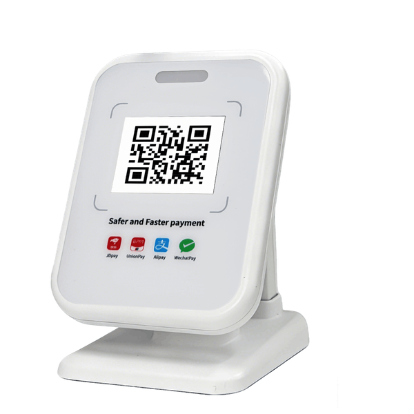
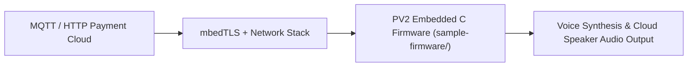

<div align="center">
  <a href="https://www.suntekai.com">
    <picture>
      <source media="(prefers-color-scheme: dark)" srcset="https://raw.githubusercontent.com/SUNTEK-Official/.github/main/profile/assets/logo-dark.png">
      <source media="(prefers-color-scheme: light)" srcset="https://raw.githubusercontent.com/SUNTEK-Official/.github/main/profile/assets/logo-light.png">
      
    </picture>
  </a>

  <h1>SUNTEK PV2 Cloud Audio Speaker Embedded C SDK</h1>

  <p>
    <strong>Official Hardware SDK &amp; Developer Kit</strong> &middot; <em>Enjoy Smarter Service</em><br>
    Embedded C audio synthesis, MQTT/HTTP notification, and device management SDK for <strong>SUNTEK PV2</strong> smart cloud speakers (<strong>SUNTEK Technology Co., Ltd.</strong>).
  </p>

  <p>
    <a href="./LICENSE"></a>
    <a href="https://github.com/SUNTEK-Official/suntek-sdk-speaker-pv2/releases"></a>
    
    <a href="https://www.suntekai.com/products/cloud-sound-box-pv2/"></a>
    <a href="mailto:support@suntekai.com"></a>
  </p>

  <p>
    <a href="#hardware-showcase--compatibility">Hardware</a> &nbsp;&bull;&nbsp;
    <a href="#architecture--key-capabilities">Architecture</a> &nbsp;&bull;&nbsp;
    <a href="#supported-interfaces--physical-connections">Interfaces</a> &nbsp;&bull;&nbsp;
    <a href="#5-minute-quick-start">Quick Start</a> &nbsp;&bull;&nbsp;
    <a href="#sample-apps--prebuilt-downloads">Downloads</a> &nbsp;&bull;&nbsp;
    <a href="#troubleshooting--faq">FAQ</a> &nbsp;&bull;&nbsp;
    <a href="#documentation-changelog--support">Support</a>
  </p>
  
</div>

---

## Hardware Showcase & Compatibility

<table>
  <tr>
    <td align="center" width="38%">
      <a href="https://www.suntekai.com/products/cloud-sound-box-pv2/">
        
      </a>
      <br>
      <strong>PV2</strong><br>
      <sub>Cloud Sound Box with mPOS Payment</sub><br>
      <a href="https://www.suntekai.com/products/cloud-sound-box-pv2/">Official Product Page</a>
    </td>
    <td valign="top" width="62%">
      <ul>
        <li><strong>Cloud Messaging</strong>: MQTT / HTTP payment broadcast notifications with TLS</li>
        <li><strong>Audio &amp; TTS</strong>: Embedded voice synthesis and WAV/MP3 prompt playback</li>
        <li><strong>Build System</strong>: GNU ARM GCC Makefile workflow (<code>sample-firmware/</code>)</li>
        <li><strong>Documentation</strong>: Cloud Speaker API Spec <code>V2.8.7</code> &amp; Manual <code>V1.0.0</code></li>
      </ul>
    </td>
  </tr>
</table>

| Product Model | Chipset / Board | OS Versions | Build Identifier | Status |
| :--- | :--- | :--- | :--- | :---: |
| **PV2 Cloud Speaker** | Embedded ARM MCU / RTOS | Firmware SDK V2.8.7 | `PV2*` | Supported |

> [!IMPORTANT]
> Verify your device **Model** and **Build Number** under Android **Settings -> About device** before integration. Customer applications use your own Google Play or enterprise release certificate.

---

## Architecture & Key Capabilities

- **Embedded Real-Time Audio Broadcast**: Built-in MQTT, mbedTLS, and voice synthesis callbacks for real-time payment confirmation.
- **Complete Firmware Source Tree**: Includes `sample-firmware/` C application sources, headers, and Makefile build targets.
- **Streamlined Releases Delivery**: Heavy ARM GCC compiler archives and static `.a` binaries live on GitHub Releases with SHA-256 checksums.



---

## Supported Interfaces & Physical Connections

| Hardware Feature | Interface Type | Device Path / Service Target | Notes |
| :--- | :--- | :--- | :--- |
| **Embedded C Sample App** | GNU ARM GCC (`Makefile`) | `sample-firmware/` | Full firmware C sources, `SysLib/`, and `make/make_cmd/` helpers (117 MB GCC toolchain in Releases) |
| **Static System Libraries** | ARM Static Archives (`.a`) | `sdk/` | `PV2_SDK.a`, `libsystem.a`, and `libsystem_vfp.a` |

---

## Repository Directory Layout

```text
suntek-sdk-speaker-pv2/
├── assets/                 # PV2 product render
├── sdk/                    # Static ARM libraries (PV2_SDK.a, libsystem.a, libsystem_vfp.a)
├── sample-firmware/        # C application sources, headers & Makefile build scripts
├── docs/                   # Cloud Speaker API Spec V2.8.7 & PV2 SDK Manual V1.0.0
├── README.md
├── LICENSE
├── THIRD_PARTY_NOTICES.md
└── CHANGELOG.md
```

> All installers (`.exe`), compiled sample APKs (`.apk`), and large binary packages (> 5 MB) are hosted on [**GitHub Releases**](https://github.com/SUNTEK-Official/suntek-sdk-speaker-pv2/releases) with `SHA256SUMS.txt`.

---

## Prerequisites & Permissions

- **Platform Target**: `minSdk N/A (Embedded C)` / `targetSdk ARM Cortex RTOS`
- **App Signing Requirement**: No Android app signing required. Static ARM `.a` archives are included in `sdk/`, while the full Win32 ARM GCC toolchain and USB flash drivers live on GitHub Releases.
- **Required Permissions / Capabilities**: Embedded RTOS TCP/IP & TLS stack.

---

## 5-Minute Quick Start

### Step 1: Verify Static Libraries & Download Toolchain

```bash
ls -lh sdk/*.a
# Download the GNU ARM GCC Win32 toolchain and Drivers.rar from GitHub Releases if building on Windows
```

### Build & Run Sample Project

```bash
cd sample-firmware && make all
```

---

## Sample Apps & Prebuilt Downloads

Verified prebuilt APKs, offline SDK bundles, and checksum manifests are published on [**GitHub Releases**](https://github.com/SUNTEK-Official/suntek-sdk-speaker-pv2/releases). Verify downloaded archives before production deployment:

```bash
shasum -a 256 -c SHA256SUMS.txt
```

---

## Troubleshooting & FAQ

<details>
<summary><b>Where are `PV2_SDK.a`, `libsystem.a`, and the ARM GCC compiler toolchain?</b></summary>
<p>All static ARM `.a` libraries are included directly inside `sdk/` and `sample-firmware/SysLib/`. The 117 MB Win32 `gcc-arm-none-eabi` toolchain archive and `Drivers.rar` are hosted on GitHub Releases.</p>
</details>

<details>
<summary><b>Which manual documents the MQTT voice broadcast payloads?</b></summary>
<p>See `docs/Cloud-Speaker-API-Spec-V2.8.7.pdf` for complete payload schemas and device provisioning specs.</p>
</details>

---

## Documentation, Changelog & Support

- **Changelog**: [CHANGELOG.md](./CHANGELOG.md)
- **Developer Documentation Portal**: [suntek-docs](https://github.com/SUNTEK-Official/suntek-docs)
- **Technical Support**: [support@suntekai.com](mailto:support@suntekai.com)
- **Bug Reports**: [Open an Issue](https://github.com/SUNTEK-Official/.github/issues/new/choose)
- **Security Disclosures**: See [SECURITY.md](https://github.com/SUNTEK-Official/.github/blob/main/SECURITY.md) or email [support@suntekai.com](mailto:support@suntekai.com)

---

<div align="center">
  
  <br><br>
  <strong>SUNTEK Technology Co., Ltd.</strong> &mdash; <em>Smart Commercial Terminal Hardware Manufacturer Since 2010</em><br>
  <sub>80+ Export Countries &middot; 5,000,000+ Terminals Shipped &middot; 500+ ODM Projects &middot; ISO 9001 / ISO 14001 / ISO 27001 / CE / RoHS</sub><br>
  <sub><a href="https://www.suntekai.com">www.suntekai.com</a> &middot; Copyright &copy; 2026 SUNTEK Technology Co., Ltd. All rights reserved.</sub>
</div>
